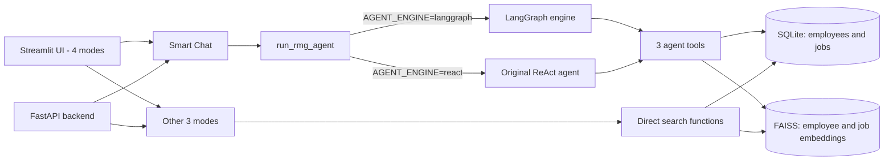
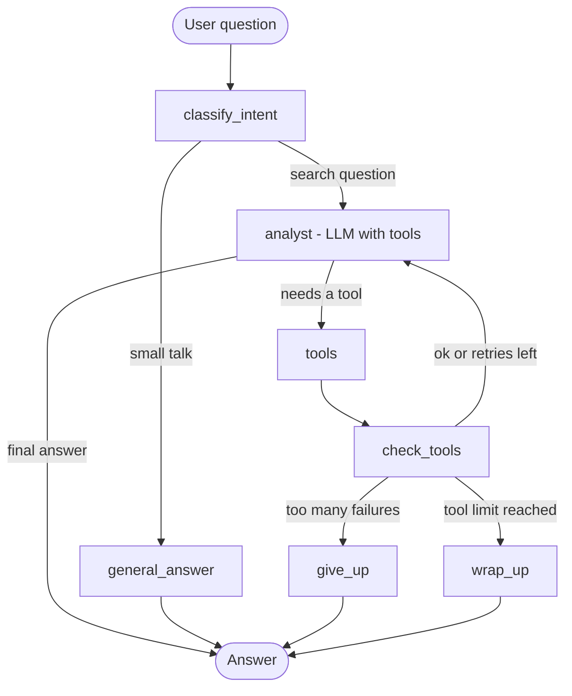

# RMG Job Matching Chatbot

> AI-powered internal talent matching system using
> semantic search and hybrid retrieval to match
> bench employees with suitable job openings.

It runs as a **Streamlit app** and a **FastAPI backend**, and the smart-chat agent supports two interchangeable engines:

- **LangGraph** (new): an explicit workflow with intent routing, bounded retries, safe fallbacks and per-session memory.
- **ReAct** (original): the first version, which parses the model's text output. Kept so the two can be compared.

# Live Demo
 [**Try the app here**] (https://rmg-chatbot.streamlit.app/)

# Problem Statement
When an employee's process closes and they go on bench, Resource Management Group (RMG) must manually screen CVs to find suitable internal roles — slow, inconsistent, and dependent on recruiter memory.

This system automates talent matching using semantic AI — finding the right match even when skill descriptions don't match word-for-word.

# Architecture

User Query
    │
    ▼
Streamlit UI (4 Modes)
    │
    ▼
FastAPI Backend
    │
    ├── /chat → ReAct Agent (3 Tools)
    │   ├── find_jobs_tool      → Employee → Jobs
    │   ├── find_employees_tool → Job → Employees
    │   └── search_bench_tool   → General Search
    │
    ├── /search/employee → Case 1 (direct)
    ├── /search/job      → Case 2 (direct)
    ├── /search/general  → Case 3 Hybrid Search
    └── /jobs            → Browse all openings
    
SQL keyword search first
→ RAG semantic fallback if insufficient
→ LLM natural language answer

# Features

**4 Search Modes in UI:**
- 💬 **Smart Chat** — Agent decides which search to run
- 👤 **Employee → Jobs** — Find jobs for a named employee
- 💼 **Job → Employees** — Find candidates for a role
- 📋 **Browse All Jobs** — Filter and explore openings

**3 Retrieval Cases:**
- **Case 1:** Employee name → SQL fetches skills →
  FAISS semantic search → Ranked jobs
- **Case 2:** Job ID → SQL fetches requirements →
  FAISS semantic search → Ranked employees
- **Case 3:** General query → SQL keyword search first →
  RAG fallback if insufficient → Merged results

# Tech Stack

| Component | Technology |
|---|---|
| UI | Streamlit |
| API | FastAPI |
| LLM | Groq Llama 3.3 70B (Free) |
| Embeddings | HuggingFace all-MiniLM-L6-v2 (Free, Local) |
| Vector Store | FAISS (Local, No API Cost) |
| Database | SQLite |
| Orchestration | LangChain |
| Agent Pattern | ReAct |

**Total API Cost: $0** — Fully open source stack

# Data

- **15 bench employees** across skills like Python,
  ML, LangChain, Java, React, DevOps, Data Engineering
- **12 job openings** across AI Engineer, Data Scientist, Frontend, Backend, DevOps, ML Engineer, and more
- **Locations:** Mumbai, Bangalore, Hyderabad, Chennai,  Pune, Delhi, Ahmedabad

# Run Locally

### Prerequisites
- Python 3.9+
- Free Groq API key from [console.groq.com](https://console.groq.com)

### Setup

# 1. Clone the repo
git clone https://github.com/maahii6/rmg-chatbot
cd rmg-chatbot

# 2. Install dependencies
pip install -r requirements.txt

# 3. Add API key
echo "GROQ_API_KEY=your_key_here" > .env

# 4. Database and vector stores are included
#    No setup needed — just run the app

# 5. Start Streamlit UI
streamlit run file.py

# 6. OR start FastAPI server
uvicorn main:app --reload
# Open: http://localhost:8000/docs

# API Endpoints

| Endpoint | Method | Description |
|---|---|---|
| `/chat` | POST | Smart agent — all cases |
| `/jobs` | GET | List jobs with filters |
| `/search/employee` | POST | Employee → Jobs |
| `/search/job` | POST | Job → Employees |
| `/search/general` | POST | Hybrid search |
| `/health` | GET | Health check |

# Why This Is Different From Keyword Search

SQL keyword search requires exact matches.
This system finds matches by **meaning**:

```
Job needs:  "Python, LLM, RAG, LangChain"
Employee has: "AI development, vector databases,
               language model deployment"

Keyword search: NO MATCH ❌
Semantic search: STRONG MATCH ✅ (Score: 0.82)
```

# Project Structure

rmg-chatbot/
├── main.py              # FastAPI + all endpoints
├── utils.py             # Core logic + agent tools
├── setup_data.py        # Creates DB + vector stores
├── schemas.py           # Pydantic models
├── file.py              # Streamlit UI (4 modes)
├── requirements.txt
├── rmg_database.db      # SQLite (employees + jobs)
├── vectorstore_jobs/    # FAISS job index
├── vectorstore_employees/ # FAISS employee index
└── screenshots/         # Demo screenshots

## I've rebuilt the original version and added LangGraph to it. ##

## Architecture



**Retrieval pipeline:** SQL keyword search first, then RAG semantic fallback if the results are insufficient, then an LLM natural-language answer.

### The three agent tools

| Tool | Use |
|---|---|
| `find_jobs_tool` | A named employee wants placement options (Employee to Jobs). |
| `find_employees_tool` | Fill a role. Accepts a job ID or a job title (Job to Employees). |
| `search_bench_tool` | Broad search by skill, location, experience or gender. Keyword search ranked by number of matches, with a semantic fallback. |

### The LangGraph workflow



| Step | What happens |
|---|---|
| `classify_intent` | Keywords (job, skill, bench, city names, job IDs and so on) mark a search question. If none match, the LLM is asked. If that call fails, the question is treated as a search. |
| `analyst` | The LLM chooses which tool to call, using the model's native tool calling. If the model call fails, it retries once, then returns a clear message. |
| `tools` | Runs the chosen tool. A crash becomes an error message instead of taking the app down. |
| `check_tools` | Looks at the results. Crashes and error replies count as failures and go back to the model with the error text. A normal "no employee found" is **not** a failure. |
| `give_up` | After 3 failed tries (1 attempt + 2 retries), stops with a clear message. |
| `wrap_up` | If the tool limit (5 rounds) is reached, the model answers from the results it already collected. |
| `general_answer` | Replies to greetings and "what can you do?" without any tool. |

Other design choices:

- **Memory:** LangGraph's built-in checkpointer, one thread per `session_id`. Only the last 3 user turns are sent to the model. The original ReAct agent had no memory.
- **Safety limits:** max retries (2), max tool rounds (5) and a hard recursion limit, so a question can never loop forever.
- **Non-invasive switch:** `run_rmg_agent()` imports the LangGraph module only when `AGENT_ENGINE=langgraph`. The original ReAct code is untouched and both engines share the same tools, data and LLM.

## Features

**4 search modes in the UI**

| Mode | What it does |
|---|---|
| **Smart Chat** | The agent decides which search to run. |
| **Employee to Jobs** | Find jobs for a named employee, with a short reason for each match. CSV download. |
| **Job to Employees** | Find candidates for a role, with a short reason for each match. CSV download. |
| **Browse All Jobs** | Filter and explore openings. CSV download. |

Only **Smart Chat** uses the agent. The other three modes call functions directly, so the agent engine does not affect them.

**3 retrieval cases**

- **Case 1:** employee name, then SQL fetches skills, then FAISS semantic search, then ranked jobs.
- **Case 2:** job ID, then SQL fetches requirements, then FAISS semantic search, then ranked employees.
- **Case 3:** general query, then SQL keyword search first, then RAG fallback if insufficient, then merged results.

## What changed in the LangGraph upgrade, and why

| # | Change | Why |
|---|---|---|
| 1 | **Added a LangGraph engine** (`langgraph_agent.py`) | The original agent relied on the model writing exact `Thought / Action / Observation` text, and was rebuilt on every request with no memory and a basic failure path. LangGraph uses native tool calling and gives explicit control over routing, retries, limits and fallbacks. |
| 2 | **Engine switch** (`AGENT_ENGINE`) | Lets both engines run on the same tools and data, so they can be compared. |
| 3 | **Replaced the Groq model** `llama-3.3-70b-versatile` with `openai/gpt-oss-120b` | Groq retired `llama-3.3-70b-versatile` on 16 August 2026 ([Groq deprecations](https://console.groq.com/docs/deprecations)), so every request returns a 404. The model name is now read from the `GROQ_MODEL` environment variable. |
| 4 | **Fixed the agent's search tools** (see [Tool bugs](#tool-bugs-found-and-fixed)) | Punctuation, plurals and partial job names broke matching, and "male" also matched "female". |
| 5 | **Added session memory** (`session_id` in `/chat` and the Streamlit chat) | Follow-ups like "what about Priya Sharma?" now work. Clear Chat also clears the agent's memory. |
| 6 | **Pinned dependencies together** (`requirements.txt`) | The file listed every package twice, and `pydantic==2.7.1` is too old for LangGraph. An unpinned LangGraph can also pull in a `langchain-core` that breaks `langchain-groq`. |
| 7 | **Added prompt rules** | The model must use tools for all names and jobs, never invent employees, scores or job IDs, treat extra reasoning as possibilities, say plainly when nothing is found, and never offer to post, edit or delete records. |
| 8 | **Added a comparison script** (`compare_engines.py`) | To compare the two engines on the same questions and check answers against the database. |

## ReAct vs LangGraph

### Was LangGraph needed?

Not strictly. A large part of the benefit comes from **native tool calling**, where the model returns a structured tool request instead of text that code must parse. A simpler tool-calling agent would also provide that. LangGraph adds explicit control around it: routing, bounded retries, limits and fallbacks, in a workflow that is easy to explain and debug. With only three tools, a simple loop could be enough.

### Differences

| | **Original ReAct agent** | **LangGraph agent** |
|---|---|---|
| How a tool is chosen | The model writes text; code parses the `Action:` line | The model returns a structured tool request |
| Who controls the flow | Mostly the model | The workflow: routes, limits and fallbacks are in code |
| Small talk | Goes through the full tool loop | Routed away from the tools |
| When a tool fails | Parsing errors or the iteration limit (5) | The model sees the error and retries up to 2 times, then stops with a clear message |
| When it takes too many steps | Stops with an error-style message | Answers from the data it already collected |
| Memory | None | Built in, per session |
| Setup | Rebuilds the agent on every request | Graph built once and reused |
| Depends on the model's exact text format | **Yes** | **No** |

### Advantages and limitations

**ReAct**
- Advantage: short, simple and easy to explain; works well when the model follows the format.
- Limitation: breaks when the model changes; little control over failures; no memory.

**LangGraph**
- Advantage: predictable behaviour with explicit limits, retries and fallbacks; memory; easier to debug and extend.
- Limitation: more code and concepts (state, nodes, edges).
- Limitation: it does not make the model smarter, so explanations can still be wrong.
- Limitation: memory is held in the running process and is lost on restart.

### Which is better?

For this project on `gpt-oss-120b`, LangGraph is the safer choice because it does not depend on a text format the model may not follow. **A measured ReAct-vs-LangGraph comparison for this project has not been run yet** (see [Evaluation](#evaluation)). A similar comparison on a sibling project (a KPI analytics agent) showed ReAct failing most questions on this model while LangGraph answered all of them, but that should not be assumed to carry over.

## Tool bugs found and fixed

All were found by testing realistic phrasings against the original tools. They are in the agent's tools, not in LangGraph.

| Problem in the original tools | Example | Now |
|---|---|---|
| Punctuation stayed attached to words | "Python developers in **Mumbai?**" ignored Mumbai, so people from other cities were listed | Punctuation is removed and plurals are handled |
| "male" matched "female" | "male engineers" also returned women | `male` / `female` match the gender field exactly |
| Job lookup was too strict | "Fill the AI Engineer **opening**" and "Fill **JOB003 please**" returned "No job found" | Finds a job ID anywhere in the text, then the full title, then the title words |
| Silent first match | "Engineer" quietly picked one of six jobs | The result names the other matching jobs |
| Keyword search matched any word, with no ranking | Results were in arbitrary order | Employees are ranked by how many keywords they match; if no one matches all of them, the result says so |

## Tech stack

| Component | Technology |
|---|---|
| UI | Streamlit |
| API | FastAPI |
| LLM | Groq `openai/gpt-oss-120b` (free tier); previously Llama 3.3 70B |
| Embeddings | HuggingFace `all-MiniLM-L6-v2` (free, local) |
| Vector store | FAISS (local, no API cost) |
| Database | SQLite |
| Orchestration | LangChain |
| Agent | LangGraph (new) and ReAct (original) |

**API cost: $0** on the Groq free tier (subject to its rate limits). Libraries and the embedding model are open source.

## Data

- **15 bench employees** across skills like Python, ML, LangChain, Java, React, DevOps and Data Engineering
- **12 job openings** across AI Engineer, Data Scientist, Frontend, Backend, DevOps, ML Engineer and more
- **Locations:** Mumbai, Bangalore, Hyderabad, Chennai, Pune, Delhi, Ahmedabad

## Why this is different from keyword search

SQL keyword search requires exact matches. This system also finds matches by meaning. An illustrative example (exact scores will differ):

```
Job needs:    "Python, LLM, RAG, LangChain"
Employee has: "AI development, vector databases,
               language model deployment"

Keyword search:  NO MATCH
Semantic search: STRONG MATCH
```

## Run locally

Use **Python 3.11** (what the project was developed on). Newer versions may not have wheels for the pinned packages. You need a free Groq API key from [console.groq.com](https://console.groq.com).

```bash
# 1. Clone
git clone https://github.com/maahii6/rmg-chatbot
cd rmg-chatbot

# 2. Install
pip install -r requirements.txt

# 3. Add your API key (never commit this file)
echo "GROQ_API_KEY=your_key_here" > .env
# optional: GROQ_MODEL=openai/gpt-oss-120b

# 4. The database and vector stores are included. No setup needed.
#    Run `python setup_data.py` only if they are missing.

# 5. Start the Streamlit UI
AGENT_ENGINE=langgraph streamlit run file.py
```

On Windows PowerShell:

```powershell
$env:AGENT_ENGINE="langgraph"
streamlit run file.py
```

If `AGENT_ENGINE` is not set, the original ReAct path runs.

**Or start the FastAPI server** (port 8000, docs at `http://localhost:8000/docs`):

```bash
AGENT_ENGINE=langgraph uvicorn main:app --reload
```

The Streamlit app runs the agent itself and does not call the API.

## API endpoints

| Endpoint | Method | Description |
|---|---|---|
| `/chat` | POST | Smart agent, all cases. Body `{"query": "...", "session_id": "..."}`; `session_id` is optional and defaults to `default`. Use a different one for each user or chat. |
| `/jobs` | GET | List jobs with optional `location` and `title` filters |
| `/search/employee` | POST | Employee to Jobs. Body `{"employee_name": "...", "top_k": 5}` |
| `/search/job` | POST | Job to Employees. Body `{"job_id": "JOB001", "top_k": 5}` |
| `/search/general` | POST | Hybrid search. Body `{"query": "...", "top_k": 5}` |
| `/health` | GET | Health check |

## Project structure

```
rmg-chatbot/
├── main.py                  FastAPI + all endpoints
├── utils.py                 Core logic, the 3 agent tools, the original ReAct agent,
│                            and run_rmg_agent() with the engine switch
├── langgraph_agent.py       LangGraph engine
├── setup_data.py            Creates the database and vector stores
├── schemas.py               Pydantic models
├── file.py                  Streamlit UI (4 modes)
├── compare_engines.py       Runs the same questions through both engines
├── requirements.txt         Pinned dependencies
├── rmg_database.db          SQLite (employees and jobs)
├── vectorstore_jobs/        FAISS job index
├── vectorstore_employees/   FAISS employee index
└── screenshots/             Demo screenshots
```

## Evaluation

`compare_engines.py` runs 8 questions through both engines with the same model, tools and data. After every answer it runs an automatic check against `rmg_database.db`:

| Question | Automatic check |
|---|---|
| Find a job for Abhay Kumar | Mentions at least one real job and no job ID that does not exist |
| Fill the AI Engineer opening | Names real employees and no job ID that does not exist |
| Fill JOB005 | Same |
| We need a Data Scientist urgently | Same |
| Python developers in Mumbai | Names at least one employee who has Python skills and is in Mumbai |
| Who has Power BI skills? | Every named employee has Power BI in their skills |
| Find female engineers on bench | Every named employee is female |
| Find a job for Zorro Nonexistent | Says the employee was not found instead of inventing results |

It also records whether the expected tool was used, the time and the number of tool calls, and writes `engine_comparison.md` (every answer side by side) and `engine_comparison.json`.

```bash
python compare_engines.py
```

| Variable | Effect |
|---|---|
| `COMPARE_ENGINES=langgraph` | Run only LangGraph and reuse the saved ReAct results from the last run. |
| `COMPARE_PAUSE=15` | Seconds to wait between runs (Groq free-tier limits). |
| `COMPARE_RATE_WAIT=65` | Seconds to wait before retrying once after a rate limit. |

The automatic check catches wrong facts that SQL can test (gender, city, skills, names, job IDs). It cannot judge whether a recommendation is a *good* match, so read the answers too.

## Lessons learned

1. **Test your tools with realistic phrasing.** A trailing question mark, a plural, or the word "opening" broke matching. These bugs had nothing to do with which agent engine was used.
2. **Depending on a text format is fragile.** Native tool calling removes that dependency.
3. **Do not depend on a single model name.** The model retirement broke the app. Reading the name from an environment variable turns the next one into a one-line change.
4. **Pin dependencies together.** One unpinned package, or one too-old pin, can break a working environment.
5. **Check answers against the data,** not only whether an answer was returned.
6. **Treat "not found" as a normal answer.** Retrying a search for an employee who does not exist wastes tokens.

## Future work

- Run the comparison and add the results above.
- Add location to the job-to-candidate ranking.
- Show cosine similarity (or a clearer label) instead of `1 / (1 + distance)`.
- Match keywords on whole words instead of substrings.
- Handle ambiguous names by asking which employee was meant.
- Use a persistent checkpointer so memory survives restarts, and give each visitor their own session.
- Add automated tests for the tools and the graph routing.
- Add an approval step before CSV export.

